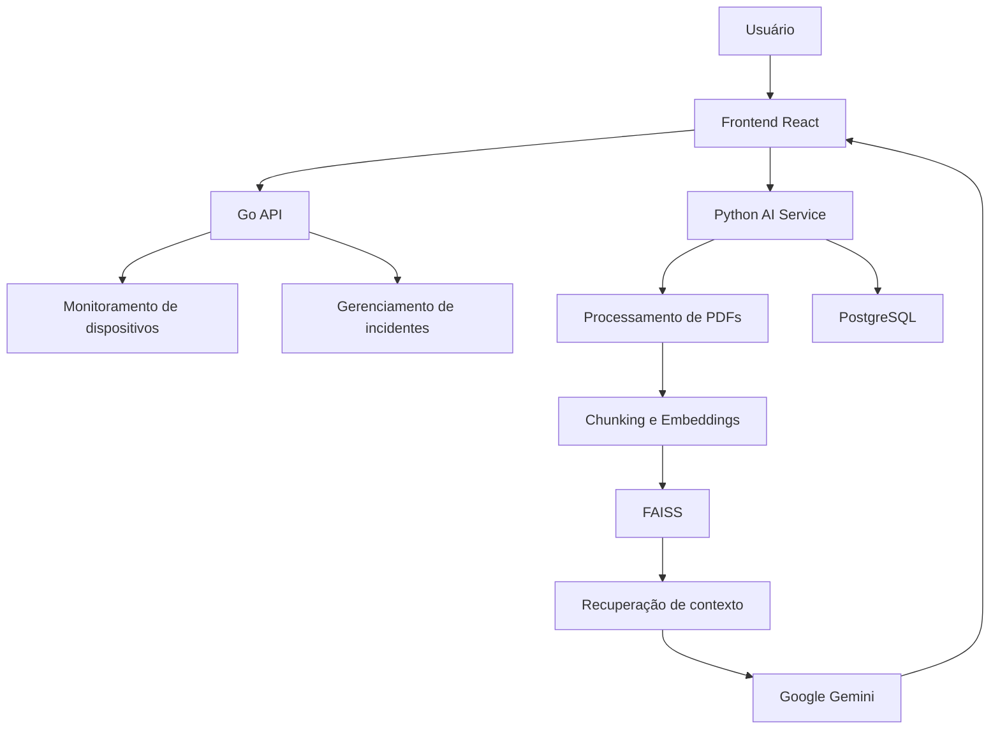

# NetWatch AI

### Intelligent Network Monitoring & AI-Powered Technical Documentation

**NetWatch AI** é uma plataforma inteligente para monitoramento de infraestrutura de redes e consulta de documentação técnica utilizando **Inteligência Artificial**.

A solução combina monitoramento de dispositivos, análise de disponibilidade, gerenciamento de incidentes e um assistente de IA capaz de interpretar documentos técnicos em PDF e responder perguntas com base nas informações encontradas.

O objetivo é centralizar informações da infraestrutura de rede em uma única plataforma, facilitando o acompanhamento dos equipamentos e o acesso ao conhecimento técnico.

---

## Funcionalidades

### 1. Monitoramento de Rede

A plataforma contará com um painel centralizado para acompanhamento dos dispositivos conectados à infraestrutura.

- **Cadastro e gerenciamento** de dispositivos.
- Identificação de equipamentos por **endereço IP**.
- Monitoramento de disponibilidade.
- Identificação de dispositivos **online e offline**.
- Histórico de alterações de status.
- Registro e acompanhamento de incidentes.
- Indicadores gerais da infraestrutura.
- **Descoberta automática** de dispositivos na rede.

### 2. Dashboard de Infraestrutura

Interface para visualização consolidada do ambiente monitorado.

- Total de dispositivos cadastrados.
- Quantidade de dispositivos online e offline.
- Indicadores de disponibilidade.
- Histórico de incidentes.
- Visualização dos equipamentos monitorados.
- Gráficos e indicadores de desempenho.

### 3. Gerenciamento de Documentação Técnica

Biblioteca centralizada para armazenar e consultar documentos técnicos.

- Upload de documentos **PDF**.
- Indexação automática do conteúdo.
- Suporte a múltiplos documentos.
- Organização e identificação dos arquivos.
- Consulta de documentos indexados.
- Reindexação de documentos atualizados.
- Identificação das fontes utilizadas nas respostas.

### 4. Assistente Técnico com Inteligência Artificial

Assistente conversacional integrado ao **Google Gemini**, desenvolvido para responder perguntas técnicas utilizando informações recuperadas da documentação cadastrada.

- Processamento de perguntas em linguagem natural.
- Consulta contextualizada a documentos PDF.
- Recuperação semântica de informações.
- Geração de respostas com base nos documentos disponíveis.
- Exibição das fontes e páginas utilizadas.
- Histórico de conversas.
- Contextualização de perguntas anteriores.
- Tratamento de perguntas sem informações suficientes na documentação.

### 5. Base de Conhecimento com RAG

Implementação de uma arquitetura **RAG (Retrieval-Augmented Generation)** para conectar os documentos técnicos ao modelo de Inteligência Artificial.

**Fluxo de processamento:**

1. Upload do documento PDF.
2. Extração do conteúdo textual.
3. Divisão do conteúdo em pequenos trechos (*chunks*).
4. Geração de embeddings.
5. Armazenamento dos vetores no **FAISS**.
6. Recuperação dos trechos mais relevantes para cada pergunta.
7. Envio do contexto recuperado ao **Google Gemini**.
8. Geração da resposta com referência às fontes utilizadas.

---

## Arquitetura do Projeto

O projeto utiliza uma arquitetura dividida em três componentes principais:

| Componente | Responsabilidade | Tecnologia |
|---|---|---|
| Backend | API de monitoramento de rede | Go |
| AI Service | Processamento de documentos e IA | Python / FastAPI |
| Frontend | Interface de interação | React |

### Fluxo da Aplicação



---

## Tecnologias Utilizadas

### Backend

- **Go**
- **REST API**
- **Python**
- **FastAPI**

### Inteligência Artificial

- **Google Gemini API**
- **Retrieval-Augmented Generation (RAG)**
- **Embeddings**
- **FAISS**
- Processamento de documentos PDF

### Banco de Dados e Armazenamento

- **PostgreSQL**
- **FAISS Vector Store**

### Frontend

- **React**
- **Vite**
- **Tailwind CSS**
- **Lucide React**
- **JavaScript**

### Ferramentas

- **Git**
- **GitHub**
- **Visual Studio Code**
- **Swagger / OpenAPI**

---

## Estrutura do Projeto

```text
netwatch-api/
│
├── ai-service/
│   ├── app/
│   │   ├── core/
│   │   ├── repositories/
│   │   ├── routes/
│   │   ├── schemas/
│   │   └── services/
│   │
│   ├── storage/
│   ├── .env.example
│   └── requirements.txt
│
├── frontend/
│   ├── src/
│   │   ├── services/
│   │   ├── App.jsx
│   │   └── index.css
│   │
│   ├── public/
│   └── package.json
│
├── internal/
│   ├── handlers/
│   ├── models/
│   ├── repository/
│   └── services/
│
├── .gitignore
└── README.md
```

---

## API

### Go API

| Método | Endpoint | Descrição |
|---|---|---|
| GET | `/api/health` | Verificar disponibilidade da API |
| GET | `/api/devices` | Listar dispositivos |
| GET | `/api/devices/{id}` | Consultar dispositivo |
| GET | `/api/devices/{id}/status` | Consultar status |
| GET | `/api/devices/{id}/incidents` | Consultar incidentes |

### Python AI Service

| Método | Endpoint | Descrição |
|---|---|---|
| GET | `/api/health` | Verificar disponibilidade do serviço |
| POST | `/api/documents/upload` | Enviar e indexar documento PDF |
| POST | `/api/documents/ask` | Enviar pergunta ao assistente |
| GET | `/api/documents/conversations` | Listar conversas |
| GET | `/api/documents/conversations/{conversation_id}` | Consultar conversa |

A documentação interativa da API Python está disponível pelo **Swagger**:

`http://localhost:8000/docs`

---

## Como Executar

### Pré-requisitos

- **Go** instalado.
- **Python 3.12** ou superior.
- **Node.js e npm**.
- **PostgreSQL**.
- Chave de API do **Google Gemini**.

### 1. Clonar o Repositório

```bash
git clone https://github.com/SEU-USUARIO/netwatch-api.git
cd netwatch-api
```

### 2. Configurar o Serviço de IA

```bash
cd ai-service

python -m venv .venv
```

Ativar o ambiente virtual no Windows:

```powershell
.\.venv\Scripts\Activate.ps1
```

Instalar dependências:

```bash
pip install -r requirements.txt
```

Configurar as variáveis de ambiente conforme o arquivo **.env.example**, incluindo a conexão com PostgreSQL e a chave da API Gemini.

Iniciar o serviço:

```bash
python -m uvicorn app.main:app --reload
```

### 3. Executar o Frontend

Em outro terminal:

```bash
cd frontend

npm install
npm run dev
```

O frontend estará disponível em:

`http://localhost:5173`

### 4. Executar a API Go

Na raiz do projeto:

```bash
go run .
```

Ajuste o comando conforme o ponto de entrada da aplicação, caso necessário.

---

## Roadmap

O projeto está em desenvolvimento e possui as seguintes etapas:

### Implementado

- [x] Estrutura inicial da API em Go.
- [x] Endpoints de gerenciamento de dispositivos.
- [x] Estrutura inicial do serviço Python com FastAPI.
- [x] Integração com Google Gemini.
- [x] Configuração do PostgreSQL.
- [x] Processamento e indexação de PDFs.
- [x] Geração de embeddings.
- [x] Recuperação semântica com FAISS.
- [x] Assistente técnico com RAG.
- [x] Histórico de conversas no backend.
- [x] Interface inicial em React.
- [x] Integração inicial entre frontend e serviço de IA.

### Em Desenvolvimento e Planejado

- [ ] Upload de PDFs diretamente pela interface.
- [ ] Biblioteca de documentos com gerenciamento completo.
- [ ] Histórico de conversas integrado à interface.
- [ ] Dashboard de monitoramento.
- [ ] Descoberta automática de dispositivos na rede.
- [ ] Monitoramento contínuo de disponibilidade.
- [ ] Histórico e visualização de incidentes.
- [ ] Integração entre monitoramento e assistente de IA.
- [ ] Melhorias de segurança, observabilidade e experiência do usuário.

---

## Objetivo

O **NetWatch AI** busca demonstrar a aplicação prática de desenvolvimento backend, integração entre serviços, bancos de dados, monitoramento de redes e Inteligência Artificial.

A proposta é desenvolver uma solução que una **infraestrutura de redes e IA generativa**, permitindo que informações técnicas sejam consultadas de forma mais rápida, organizada e contextualizada.

---

**Status:** Em desenvolvimento.
